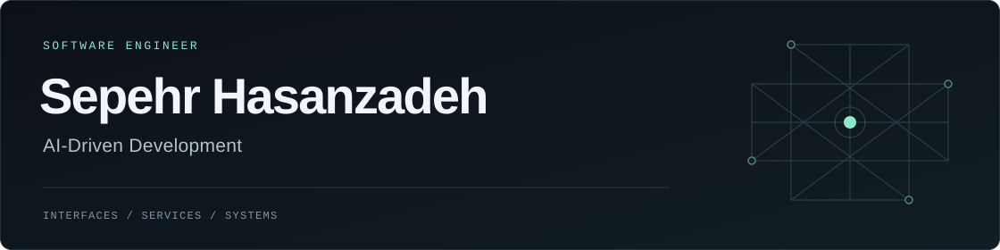
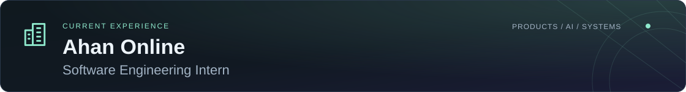
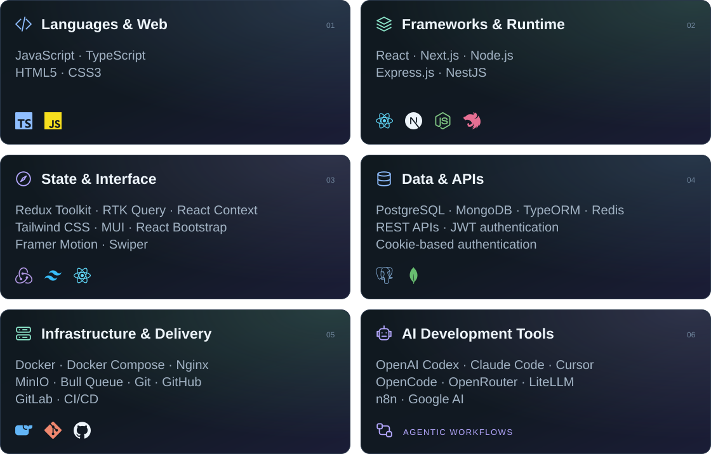
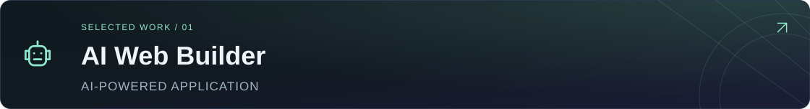
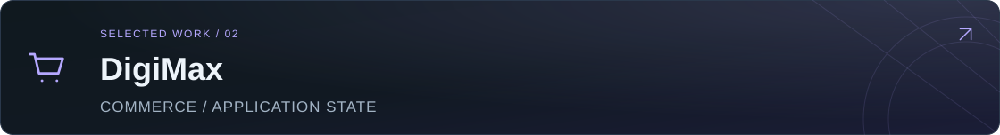

  

I build software across interfaces, services, and infrastructure, using AI coding agents to move from ideas to working products.

  
  
  

<h2> About Me</h2>

I'm **Sepehr Hasanzadeh**, a **Software Engineer** and Computer Engineering student specializing in Software Engineering. I'm currently a **Software Engineering Intern at Ahan Online**.

My focus is on understanding how a product works as a whole: its user experience, application logic, data, and delivery. I use AI-driven development to explore architecture, implement features, debug issues, and solve engineering problems, with attention to clear design and maintainable code.

<h2> Current Experience</h2>

<a href="https://ahanonline.com/">
  <picture>
    <source media="(max-width: 600px)" srcset="https://raw.githubusercontent.com/sepehrhasanzadeh/sepehrhasanzadeh/main/assets/experience-mobile.svg">
    
  </picture>
</a>

Working and learning on real-world software products, with experience spanning application development, system architecture, AI integration, and development infrastructure.

- Developing backend features and learning architectural patterns with **NestJS, TypeORM, and PostgreSQL**.
- Working on AI-powered applications, model integration, and agent-based workflows.
- Using **Docker** and development infrastructure while building an understanding of production environments and software delivery.
- Applying AI coding agents to implementation, debugging, and day-to-day engineering tasks.

<h2> Technical Stack</h2>

Technologies I've worked with across professional work, personal projects, and learning.

<picture>
  <source media="(max-width: 600px)" srcset="https://raw.githubusercontent.com/sepehrhasanzadeh/sepehrhasanzadeh/main/assets/stack-mobile.svg">
  
</picture>

<strong>Explore the full technology index</strong>

| Area | Technologies |
| :--- | :--- |
| **Languages & web foundations** | JavaScript, TypeScript, HTML5, CSS3 |
| **Application frameworks** | React, Next.js, Node.js, Express.js, NestJS |
| **State & data fetching** | Redux Toolkit, RTK Query, React Context |
| **UI & interaction** | Tailwind CSS, Material UI (MUI), React Bootstrap, Framer Motion, Swiper |
| **Data & APIs** | PostgreSQL, MongoDB, TypeORM, Redis, REST APIs, JWT authentication, cookie-based authentication |
| **Infrastructure & delivery** | Docker, Docker Compose, Nginx, MinIO, Bull Queue, Git, GitHub, GitLab, CI/CD |
| **AI development tools** | OpenAI Codex, Claude Code, Cursor, OpenCode, OpenRouter, LiteLLM, n8n, Google AI |

<h2> AI & Engineering Workflow</h2>

AI-assisted engineering is part of how I build: from exploring system design to implementation, debugging, and iteration. I work with AI agents and agentic workflows, keeping engineering decisions, code review, and validation central to the process.

<picture>
  <source media="(max-width: 600px)" srcset="https://raw.githubusercontent.com/sepehrhasanzadeh/sepehrhasanzadeh/main/assets/workflow-mobile.svg">
  
</picture>

**Coding agents & editors** · OpenAI Codex, Claude Code, Cursor, OpenCode 
**Model integration & automation** · OpenRouter, LiteLLM, n8n, Google AI

<h2> Selected Projects</h2>

<a href="https://github.com/sepehrhasanzadeh/ai-web-builder">
  <picture>
    <source media="(max-width: 600px)" srcset="https://raw.githubusercontent.com/sepehrhasanzadeh/sepehrhasanzadeh/main/assets/project-ai-web-builder-mobile.svg">
    
  </picture>
</a>

An AI-assisted website builder with prompt-based page generation and section-level editing. The implementation connects an OpenAI integration to project, section, and conversation management.

TypeScript · Next.js · NestJS · TypeORM · PostgreSQL · OpenAI

  

<a href="https://github.com/sepehrhasanzadeh/DigiMax">
  <picture>
    <source media="(max-width: 600px)" srcset="https://raw.githubusercontent.com/sepehrhasanzadeh/sepehrhasanzadeh/main/assets/project-digimax-mobile.svg">
    
  </picture>
</a>

A digital-products store with authentication, product filtering, a persistent shopping cart, order placement, and customer account pages. State and API interactions use Redux Toolkit and RTK Query.

React · Redux Toolkit · RTK Query · Node.js · Express.js · MongoDB

  

<a href="https://github.com/sepehrhasanzadeh/GameSpot">
  <picture>
    <source media="(max-width: 600px)" srcset="https://raw.githubusercontent.com/sepehrhasanzadeh/sepehrhasanzadeh/main/assets/project-gamespot-mobile.svg">
    
  </picture>
</a>

A gaming-products store with customer and admin panels, inventory management, order handling, and confirmation emails. Built with a React interface and an Express API backed by MongoDB.

React · Redux · Node.js · Express.js · MongoDB

<h2> Contact & Professional Links</h2>

<picture>
  <source media="(max-width: 600px)" srcset="https://raw.githubusercontent.com/sepehrhasanzadeh/sepehrhasanzadeh/main/assets/contact-mobile.svg">
  
</picture>

  
  
  

[sepehrh471@gmail.com](mailto:sepehrh471@gmail.com)
